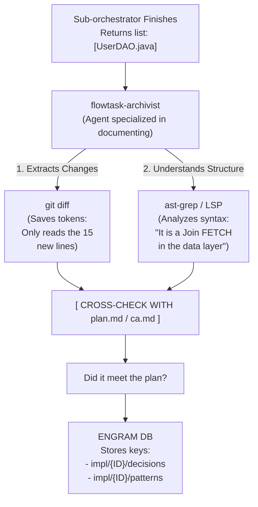

> **Historical:** `flowtask-archivist` is not part of the current agent registry. See [../project-history.md](../project-history.md).

# Archivist subagent flow



```text
┌─────────────────────────────────────────────────────────────────────────┐
│ LEGEND 3: The Archivist Flow (Efficient Memory Management)              │
├─────────────────────────────────────────────────────────────────────────┤
│ Details how the 'archivist' uses 'git diff' and 'ast-grep' cross-checked │
│ with the plan to document (without judging) technical decisions and     │
│ patterns in Engram, saving tokens by not reading the whole project.     │
└─────────────────────────────────────────────────────────────────────────┘
```
