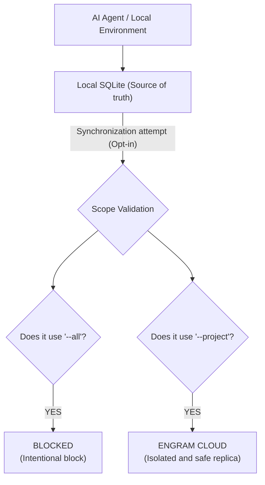

> **Historical:** this cloud synchronization design is not part of the current operational guide. See [../README.md](../README.md).

# Engram memory structure and cloud synchronization



```text
[ ENGRAM MEMORY ]
       │
       ├──→ [ GLOBAL PROJECT CONTEXT ] (Initialized by flowtask-initializer)
       │      ├─ project/stack         → Technologies used
       │      ├─ project/conventions   → Rules and conventions
       │      └─ project/{layer}       → Patterns per layer (e.g., api, data, business)
       │
       ├──→ [ ARTIFACT SNAPSHOTS ] (Key results of each task)
       │      ├─ ca/{ID}               → Acceptance Criteria snapshot (CA-Writer)
       │      ├─ plan/{ID}             → Implementation Plan snapshot (Planner)
       │      ├─ plan-audit/{ID}       → Audit results (Plan-Auditor)
       │      └─ validation/{ID}       → Validation report (Validator)
       │
       ├──→ [ FLOW STATES ] (Step-by-step control per ID)
       │      ├─ flow-state/{ID}/create    → Current CA creation state
       │      ├─ flow-state/{ID}/plan      → Current plan generation state
       │      ├─ flow-state/{ID}/audit     → Plan review state
       │      ├─ flow-state/{ID}/construct → Code/implementation phase state
       │      └─ flow-state/{ID}/validate  → Test/validation phase state
       │
       └──→ [ IMPLEMENTATION DISCOVERIES ]
              ├─ impl/{ID}/decisions   → Design decisions made
              └─ impl/{ID}/patterns    → New technical patterns discovered
```
