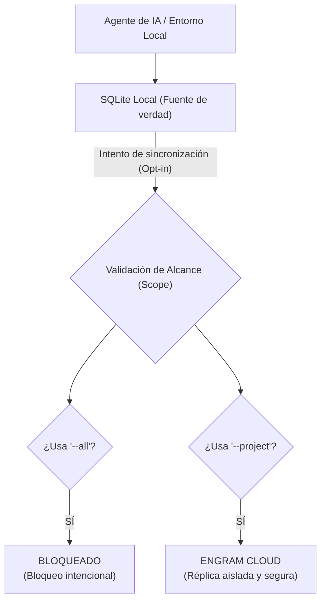

# Estructura de memoria de Engram y sincronización cloud



```text
[ MEMORIA DE ENGRAM ]
       │
       ├──→ [ CONTEXTO GLOBAL DEL PROYECTO ] (Inicializado por flowtask-initializer)
       │      ├─ project/stack         → Tecnologías utilizadas
       │      ├─ project/conventions   → Reglas y convenciones
       │      └─ project/{layer}       → Patrones por capa (ej. api, data, business)
       │
       ├──→ [ SNAPSHOTS DE ARTEFACTOS ] (Resultados clave de cada tarea)
       │      ├─ ca/{ID}               → Captura de Criterios de Aceptación (CA-Writer)
       │      ├─ plan/{ID}             → Captura del Plan de implementación (Planner)
       │      ├─ plan-audit/{ID}       → Resultados de la auditoría (Plan-Auditor)
       │      └─ validation/{ID}       → Reporte de validación (Validator)
       │
       ├──→ [ ESTADOS DE FLUJO / FLOW STATES ] (Control paso a paso por ID)
       │      ├─ flow-state/{ID}/create    → Estado actual de creación del CA
       │      ├─ flow-state/{ID}/plan      → Estado actual de generación del plan
       │      ├─ flow-state/{ID}/audit     → Estado de la revisión del plan
       │      ├─ flow-state/{ID}/construct → Estado de la fase de código/implementación
       │      └─ flow-state/{ID}/validate  → Estado de la fase de pruebas/validación
       │
       └──→ [ DESCUBRIMIENTOS DE IMPLEMENTACIÓN ]
              ├─ impl/{ID}/decisions   → Decisiones de diseño tomadas
              └─ impl/{ID}/patterns    → Nuevos patrones técnicos descubiertos
```
