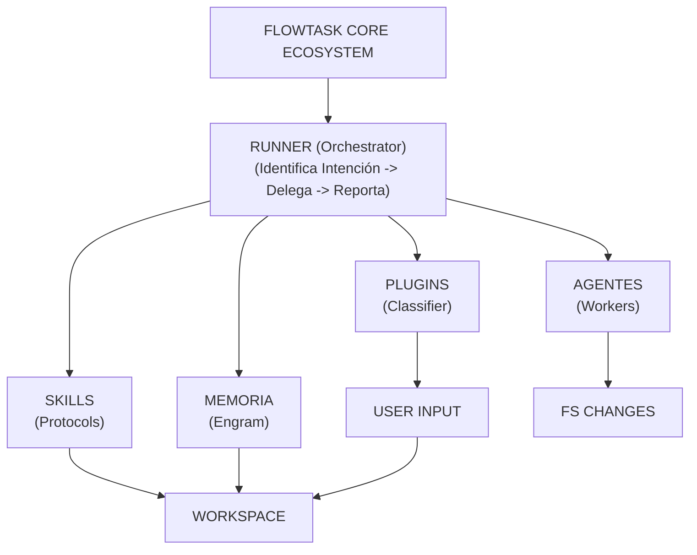

> **Histórico:** este snapshot conceptual conserva referencias al classifier y módulos retirados. No describe la arquitectura vigente. Consultá [../README.md](../README.md).

## 1. Arquitectura Global: El "Handshake" Modular

Este diagrama muestra cómo se conectan los módulos principales. El Runner no trabaja solo; orquestra la relación entre el Input, la Memoria (Engram) y los Sub-agentes.

