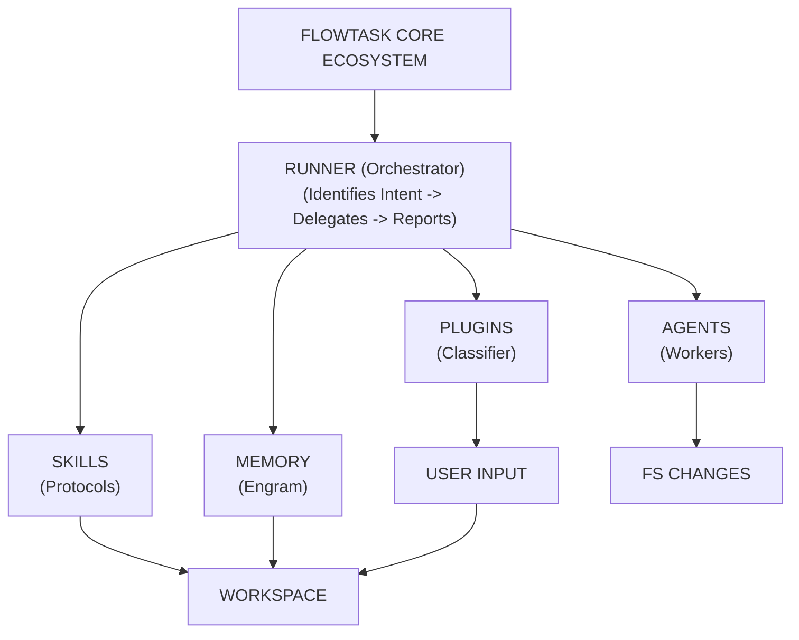

> **Historical:** this conceptual snapshot preserves references to the classifier and retired modules. It does not describe the current architecture. See [../README.md](../README.md).

## 1. Global Architecture: The Modular "Handshake"

This diagram shows how the main modules connect. The Runner does not work alone; it orchestrates the relationship between Input, Memory (Engram), and Subagents.

