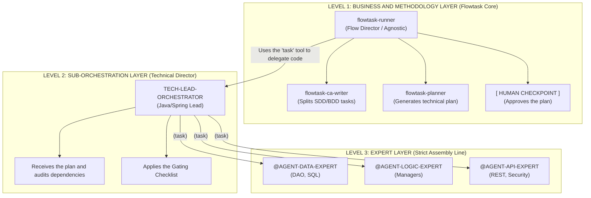

> **Historical:** this design preserves sub-orchestrators and retired conceptual paths. It does not describe the current flow. See [../README.md](../README.md).

# Systematic view of FlowTask



```text
┌────────────────────────────────────────────────────────────────────────────┐
│ LEGEND 4: Complete Flow (The 3 Architecture Layers)                        │
├────────────────────────────────────────────────────────────────────────────┤
│ Macro view of the separation of responsibilities: the 'runner'             │
│ as Methodology Director, 'TECH-LEAD-ORCHESTRATOR' as Tech Lead,            │
│ and hyper-specialized subagents as the Assembly Line.                      │
└────────────────────────────────────────────────────────────────────────────┘
```
