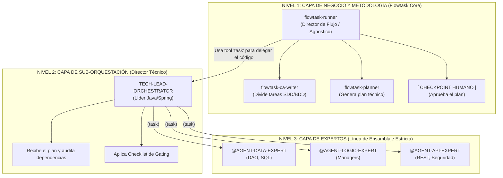

> **Histórico:** este diseño conserva sub-orquestadores y rutas conceptuales retiradas. No describe el flujo vigente. Consultá [../README.md](../README.md).

# Visión sistemática de FlowTask



```text
┌────────────────────────────────────────────────────────────────────────────┐
│ LEYENDA 4: Flujo Completo (Las 3 Capas de la Arquitectura)                 │
├────────────────────────────────────────────────────────────────────────────┤
│ Visión macro de la separación de responsabilidades: El 'runner'            │
│ como Director de Metodología, el 'TECH-LEAD-ORCHESTRATOR' como Tech Lead   │
│ y los subagentes hiper-especializados como Línea de Ensamblaje.            │
└────────────────────────────────────────────────────────────────────────────┘
```
