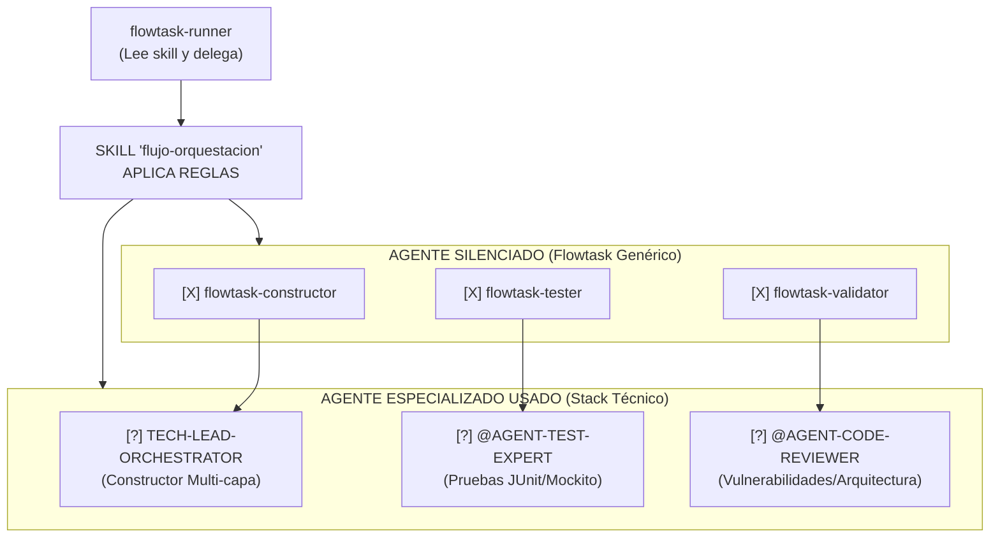

# Flujo de orquestación del Runner



```text
┌────────────────────────────────────────────────────────────────────────────┐
│ LEYENDA 2: La Skill de Enrutamiento (Comparativa de Silencio)              │
├────────────────────────────────────────────────────────────────────────────┤
│ Ilustra el contrato de exclusión. El 'runner' lee la skill y               │
│ "silencia" (omite) a los validadores genéricos de Flowtask, cediendo       │
│ el control a los expertos nativos del sub-orquestador (ej. Stack Técnico). │
└────────────────────────────────────────────────────────────────────────────┘
```
