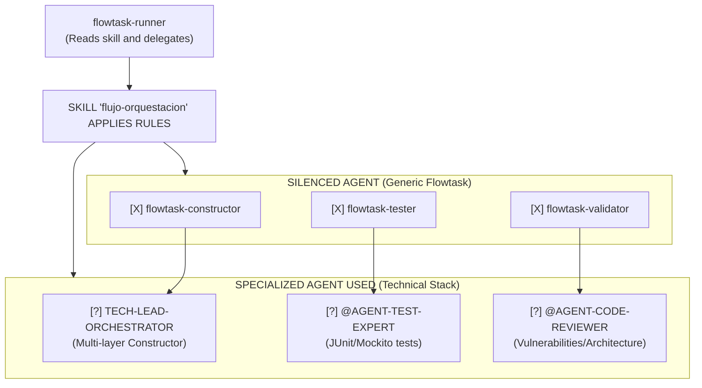

> **Historical:** this conceptual flow contains references to retired protocols. See [../project-history.md](../project-history.md).

# Runner orchestration flow



```text
┌────────────────────────────────────────────────────────────────────────────┐
│ LEGEND 2: The Routing Skill (Silence Comparison)                           │
├────────────────────────────────────────────────────────────────────────────┤
│ Illustrates the exclusion contract. The 'runner' reads the skill and       │
│ "silences" (omits) Flowtask's generic validators, handing                    │
│ control to the sub-orchestrator's native experts (e.g., Technical Stack).  │
└────────────────────────────────────────────────────────────────────────────┘
```
