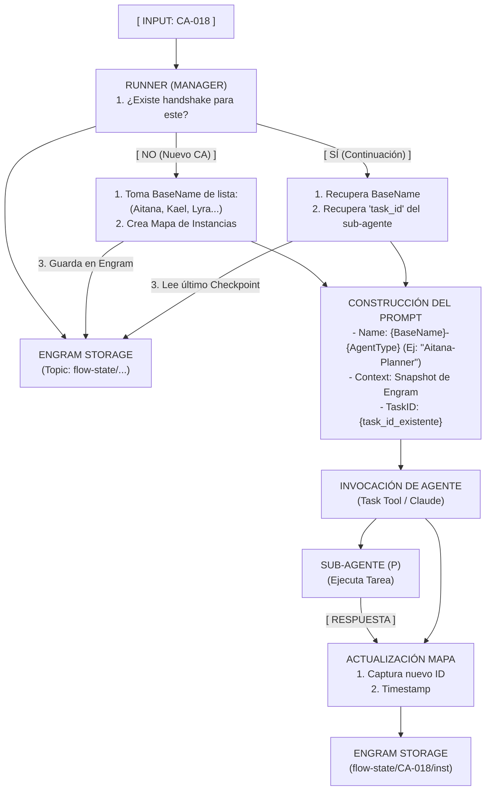

## 6. Handshake Protocol: Gestión de Identidad y Continuidad



Desglose de los Componentes del Handshake:

### 1. El Mapa de Instancias (En Engram)

Es el archivo de estado que el Runner consulta. Evita la duplicidad de hilos.

```json
{
  "base_name": "Aitana",
  "agents": {
    "ca-writer": { 
      "task_id": "T123...", 
      "instance_name": "Aitana-ca-writer",
      "last_resume": "2026-05-14T..." 
    },
    "planner": { 
      "task_id": "T456...", 
      "instance_name": "Aitana-planner"
    }
  }
}
```

### 2. Naming Pool (Identidad Visual)

El Runner asigna nombres de una lista predefinida (Aitana, Kael, Lyra, Zev, Thalía, Iago, Elowen, Mael).

*   ¿Por qué? Porque es más fácil para el desarrollador identificar que "Aitana-Planner" está hablando de lo mismo que "Aitana-Constructor", en lugar de manejar IDs de sistema aburridos.

### 3. Context Injection (La Memoria de Trabajo)

Antes de que el agente empiece a trabajar, el Runner inyecta:

1.  Hallazgos de memoria: Lo que se aprendió en sesiones anteriores.
2.  Snapshot de estado: El "en qué nos quedamos" recuperado de Engram.

### 4. Self-Healing (Recuperación Automática)

Si el task_id ha expirado (por tiempo de inactividad de la API del LLM):

1.  El Runner detecta el fallo.
2.  Limpia el ID fallido de Engram.
3.  Relanza al agente en un hilo nuevo inyectando el último Checkpoint, por lo que el agente "no siente" que perdió la memoria, solo que es un nuevo día.
