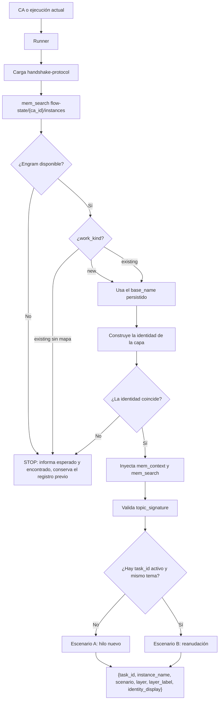

# Handshake vigente: identidad y continuidad

El Handshake Protocol coordina la identidad de las instancias y la continuidad
de los agentes que pueden reanudar una sesión. Su contrato canónico está en
`.flowtask/skills/handshake-protocol/SKILL.md`; el runner lo carga antes de
delegar cuando corresponde.

## Alcance

El protocolo aplica al tratamiento completo (`ca-writer` y `planner`). Los
agentes de tratamiento ligero (`inspector`, `constructor`, `validator`,
`tester`, `review-orchestrator`, `logger` e `initializer`) se invocan como hilo
fresco; su `instance_name` puede conservarse como traza, pero no reanudan un
`task_id` mediante este protocolo. El `constructor` tiene una excepción acotada:
puede reanudar un fallo operativo o una interrupción recuperable si su
identidad, su `task_id` y su checkpoint siguen disponibles y son restaurables.

La skill es agnóstica del mecanismo de invocación: devuelve un contrato al
orquestador y no prescribe qué herramienta debe usar para iniciar el agente.

## Capas de identidad

La identidad vive en tres capas separadas, cada una con su nombre propio:

| Capa | Etiqueta visible | Nombre de instancia |
|------|------------------|---------------------|
| `hermes` | `núcleo Hermes` | `Hermes` (reserva nominal dev-only) |
| `orchestrator` | `orquestador` | `{BaseName}` |
| `subagent` | `subagente` | `{BaseName}-{agent_type}` |

Ninguna capa puede presentarse como otra: una identidad de subagente con
nombre de orquestador, o viceversa, se rechaza y se informa. El nombre
`Hermes` está reservado y no puede usarse como nombre base ni como nombre de
subagente. La identidad se muestra con el formato `[capa: {layer_label}]
{instance_name}`, y la capa `hermes` agrega ` (dev-only)`.

Si la capa no puede mostrarse, el sistema avisa y no presenta el trabajo como
identificado.

## Flujo



La identidad faltante o distinta no sale por Escenario A: la rama STOP informa
qué se esperaba y qué se encontró, conserva lo previamente registrado y
detiene el flujo.

## Mapa de instancias

El mapa se guarda en Engram con `topic_key`
`flow-state/{ca_id}/instances`. El `BaseName` lo provee el orquestador; no está
hardcodeado en la skill. La rama base se detecta al crear el worktree en el
orden `development → main → trunk`; si ninguna existe, se usa `main` como
fallback, y se persiste junto con su contexto.

```json
{
  "base_name": "Aitana",
  "orchestrator": {
    "instance_name": "Aitana",
    "layer": "orchestrator",
    "layer_label": "orquestador"
  },
  "agents": {
    "planner": {
      "layer": "subagent",
      "layer_label": "subagente",
      "base_name": "Aitana",
      "agent_type": "planner",
      "task_id": "...",
      "instance_name": "Aitana-planner",
      "topic_signature": {
        "ids": ["CA-010"],
        "keywords": ["plan", "tareas"]
      },
      "worktree": {
        "path": ".worktrees/CA-010/",
        "branch": "worktree/CA-010",
        "base_branch": "main"
      }
    }
  }
}
```

El `task_id` se captura después de una respuesta exitosa. Los mapas antiguos
que solo contienen `task_id`, `instance_name` y `last_resume` siguen siendo
compatibles, y los mapas sin `layer` se leen como capa `subagent`.

## Contrato de salida

La skill entrega exactamente:

- `task_id`: el identificador existente para reanudar o `null` para un hilo nuevo.
- `instance_name`: identidad de la instancia, por ejemplo `Lyra-planner`.
- `scenario`: `"A"` para hilo nuevo o `"B"` para reanudación.
- `layer`: capa de identidad de la invocación.
- `layer_label`: etiqueta visible de la capa.
- `identity_display`: identidad en formato visible, `[capa: {layer_label}] {instance_name}`.

## Reglas

- **Engram no disponible detiene**: sin registro verificable no hay identidad.
  El protocolo informa qué esperaba y qué encontró, conserva lo previo y se
  detiene.
- **Un nombre por trabajo activo**: un trabajo nuevo toma el primer nombre
  libre de la lista y nunca reutiliza el nombre de un trabajo activo. Un
  nombre pedido y ocupado, un nombre duplicado entre trabajos activos o una
  lista agotada detienen el protocolo.
- **El tema verificado o la detención**: la validación de tema compara primero
  IDs y después el solapamiento de keywords con el umbral definido por la
  skill. Si el checkpoint no trae `topic_signature`, la identidad no puede
  validarse y el protocolo se detiene con `topic_unverifiable`. Si el tema
  cambió, el protocolo se detiene con `topic_mismatch`.
- **No hay Escenario A sustituto**: una identidad faltante o distinta, o un
  tema no verificable, no se compensan con un hilo nuevo: el protocolo no
  asigna un nombre sustituto, no inventa un `task_id` y no presenta un hilo
  nuevo como reanudación lograda. La continuidad se retoma solo por vía
  explícita, con restauración desde lo registrado y declarando que no hubo
  reanudación literal.
- **La purga de hilos huérfanos es manual**: los `task_id` que quedan se
  conservan como registro histórico.

Para los detalles de checkpoint, relevo por capacidad y limpieza de sesiones,
consultá `checkpoint-mixin` y el contrato del runner.

## Verificación ejecutable

El operador verifica la distinción de capas ejecutando el contrato, no solo
leyendo documentos. Desde la raíz del repositorio:

```
node .flowtask/skills/handshake-protocol/scripts/agent-identity.js check --names Aitana,Kael
```

El comando imprime una línea por capa y una por subagente, valida la unicidad
de nombres entre trabajos en paralelo y comprueba las detenciones fail-closed.
Sale 1 ante cualquier violación. Para ver solo las identidades:

```
node .flowtask/skills/handshake-protocol/scripts/agent-identity.js roles --names Aitana,Kael
```
