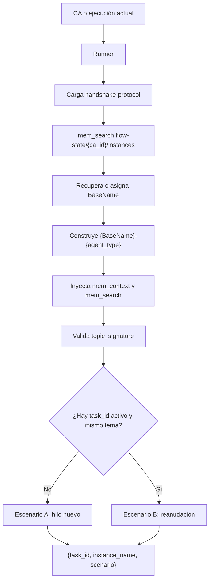

# Handshake vigente: identidad y continuidad

El Handshake Protocol coordina la identidad de las instancias y la continuidad
de los agentes que pueden reanudar una sesión. Su contrato canónico está en
`.flowtask/skills/handshake-protocol/SKILL.md`; el runner lo carga antes de
delegar cuando corresponde.

## Alcance

El protocolo aplica al tratamiento completo (`ca-writer` y `planner`). Los
agentes de tratamiento ligero (`inspector`, `constructor`, `validator`,
`tester`, `review-orchestrator`, `logger` e `initializer`) se invocan como hilo
fresco; su `instance_name` puede conservarse como traza, pero no reanudan un
`task_id` mediante este protocolo.

La skill es agnóstica del mecanismo de invocación: devuelve un contrato al
orquestador y no prescribe qué herramienta debe usar para iniciar el agente.

## Flujo



Si Engram no está disponible, el protocolo degrada a caso nuevo y Escenario A;
no existe otro mecanismo de discovery dentro de esta skill.

## Mapa de instancias

El mapa se guarda en Engram con `topic_key`
`flow-state/{ca_id}/instances`. El `BaseName` lo provee el orquestador; no está
hardcodeado en la skill. La rama base se detecta al crear el worktree en el
orden `development → main → trunk`; si ninguna existe, se usa `main` como
fallback, y se persiste junto con su contexto.

```json
{
  "base_name": "Aitana",
  "agents": {
    "planner": {
      "task_id": "...",
      "instance_name": "Aitana-planner",
      "topic_signature": {
        "ids": ["CA-010"],
        "keywords": ["plan", "tareas"]
      },
      "worktree": {
        "path": ".worktrees/CA-010/",
        "branch": "worktree/CA-010",
        "base_branch": "main"
      }
    }
  }
}
```

El `task_id` se captura después de una respuesta exitosa. Los mapas antiguos
que solo contienen `task_id`, `instance_name` y `last_resume` siguen siendo
compatibles.

## Contrato de salida

La skill entrega exactamente:

- `task_id`: el identificador existente para reanudar o `null` para un hilo nuevo.
- `instance_name`: identidad de la instancia, por ejemplo `Lyra-planner`.
- `scenario`: `"A"` para hilo nuevo o `"B"` para reanudación.

La validación de tema compara primero IDs y después el solapamiento de keywords
con el umbral definido por la skill. Si el tema cambió, fuerza Escenario A y no
elimina de inmediato el `task_id` anterior: la purga corresponde al runner.

Para los detalles de checkpoint, relevo por capacidad y limpieza de sesiones,
consultá `checkpoint-mixin` y el contrato del runner.
