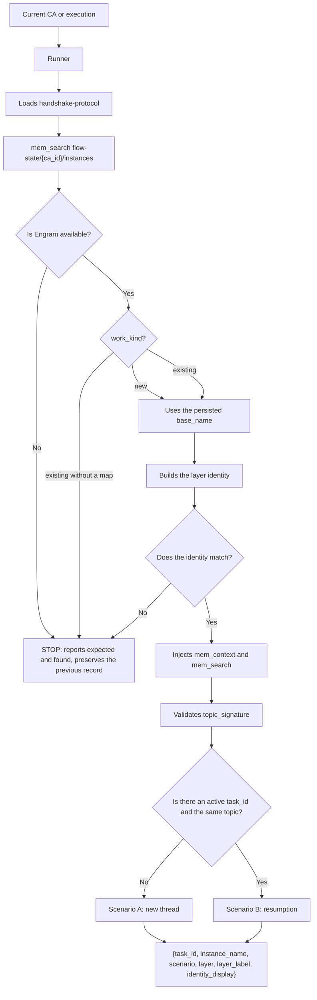

# Current Handshake: identity and continuity

The Handshake Protocol coordinates instance identity and the continuity
of agents that can resume a session. Its canonical contract is in
`.flowtask/skills/handshake-protocol/SKILL.md`; the runner loads it before
delegating when applicable.

## Scope

The protocol applies to full treatment (`ca-writer` and `planner`). Light-treatment
agents (`inspector`, `constructor`, `validator`,
`tester`, `review-orchestrator`, `logger`, and `initializer`) are invoked as fresh
threads; their `instance_name` may be kept as a trace, but they do not resume a
`task_id` through this protocol. The `constructor` has a bounded exception:
it can resume an operational failure or a recoverable interruption if its
identity, `task_id`, and checkpoint remain available and restorable.

The skill is agnostic about the invocation mechanism: it returns a contract to
the orchestrator and does not prescribe which tool to use to start the agent.

## Identity layers

Identity lives in three separate layers, each with its own name:

| Layer | Visible label | Instance name |
|------|------------------|---------------------|
| `hermes` | `núcleo Hermes` | `Hermes` (dev-only nominal reservation) |
| `orchestrator` | `orquestador` | `{BaseName}` |
| `subagent` | `subagente` | `{BaseName}-{agent_type}` |

No layer may present itself as another: a subagent identity with
an orchestrator name, or vice versa, is rejected and reported. The name
`Hermes` is reserved and cannot be used as a base name or as a subagent
name. Identity is shown in the format `[capa: {layer_label}]
{instance_name}`, and the `hermes` layer adds ` (dev-only)`.

If the layer cannot be shown, the system warns and does not present the work as
identified.

## Flow



A missing or different identity does not go through Scenario A: the STOP branch reports
what was expected and what was found, preserves what was previously recorded, and
stops the flow.

## Instance map

The map is stored in Engram with `topic_key`
`flow-state/{ca_id}/instances`. The `BaseName` is provided by the orchestrator; it is not
hardcoded in the skill. The base branch is detected when creating the worktree in
the order `development → main → trunk`; if none exists, `main` is used as a
fallback, and it is persisted together with its context.

```json
{
  "base_name": "Aitana",
  "orchestrator": {
    "instance_name": "Aitana",
    "layer": "orchestrator",
    "layer_label": "orquestador"
  },
  "agents": {
    "planner": {
      "layer": "subagent",
      "layer_label": "subagente",
      "base_name": "Aitana",
      "agent_type": "planner",
      "task_id": "...",
      "instance_name": "Aitana-planner",
      "topic_signature": {
        "ids": ["CA-010"],
        "keywords": ["plan", "tasks"]
      },
      "worktree": {
        "path": ".worktrees/CA-010/",
        "branch": "worktree/CA-010",
        "base_branch": "main"
      }
    }
  }
}
```

The `task_id` is captured after a successful response. Old maps that contain only
`task_id`, `instance_name`, and `last_resume` remain compatible, and maps without
`layer` are read as the `subagent` layer.

## Output contract

The skill returns exactly:

- `task_id`: the existing identifier to resume, or `null` for a new thread.
- `instance_name`: instance identity, for example `Lyra-planner`.
- `scenario`: `"A"` for a new thread or `"B"` for resumption.
- `layer`: identity layer of the invocation.
- `layer_label`: visible label of the layer.
- `identity_display`: identity in visible format, `[capa: {layer_label}] {instance_name}`.

## Rules

- **Engram unavailable stops**: without a verifiable record there is no identity.
  The protocol reports what it expected and what it found, preserves the previous state, and
  stops.
- **One name per active job**: a new job takes the first free name
  from the list and never reuses the name of an active job. A
  requested and occupied name, a duplicate name among active jobs, or an
  exhausted list stops the protocol.
- **Verified topic or stop**: topic validation compares IDs first and then
  keyword overlap against the threshold defined by the skill. If the checkpoint
  does not include `topic_signature`, identity cannot be validated and the protocol
  stops with `topic_unverifiable`. If the topic changed, the protocol stops with
  `topic_mismatch`.
- **No substitute Scenario A**: a missing or different identity, or an
  unverifiable topic, is not compensated with a new thread: the protocol does not
  assign a substitute name, does not invent a `task_id`, and does not present a new
  thread as a successful resumption. Continuity is resumed only through an
  explicit path, with restoration from what was recorded and declaring that there was no
  literal resumption.
- **Orphan thread purging is manual**: remaining `task_id` values are
  preserved as historical records.

For checkpoint, capacity handoff, and session cleanup details,
see `checkpoint-mixin` and the runner contract.

## Executable verification

The operator verifies layer distinction by running the contract, not just
reading documents. From the repository root:

```
node .flowtask/skills/handshake-protocol/scripts/agent-identity.js check --names Aitana,Kael
```

The command prints one line per layer and one per subagent, validates name
uniqueness across parallel jobs, and checks fail-closed stops.
It exits 1 on any violation. To see only the identities:

```
node .flowtask/skills/handshake-protocol/scripts/agent-identity.js roles --names Aitana,Kael
```
