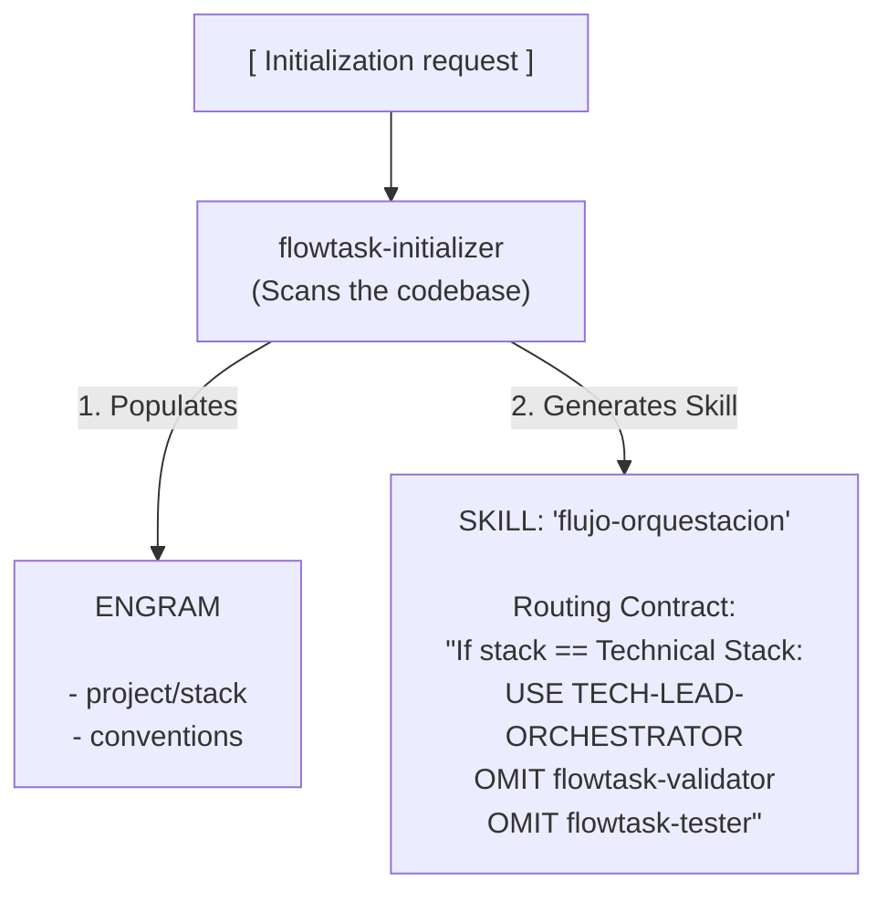

> **Historical:** this design preserves an earlier conceptual contract for the Initializer. The current source is `.flowtask/agents/initializer.md` and the installed configuration.

# Initializer subagent design



```text
┌─────────────────────────────────────────────────────────────────────────┐
│ LEGEND 1: The Initializer and Engram (Per-Project Configuration)        │
├─────────────────────────────────────────────────────────────────────────┤
│ Shows how the 'initializer' scans the codebase once,                    │
│ populates Engram memory with the stack, and generates the dynamic       │
│ routing skill that dictates the immutable rules for that session.       │
└─────────────────────────────────────────────────────────────────────────┘
```
