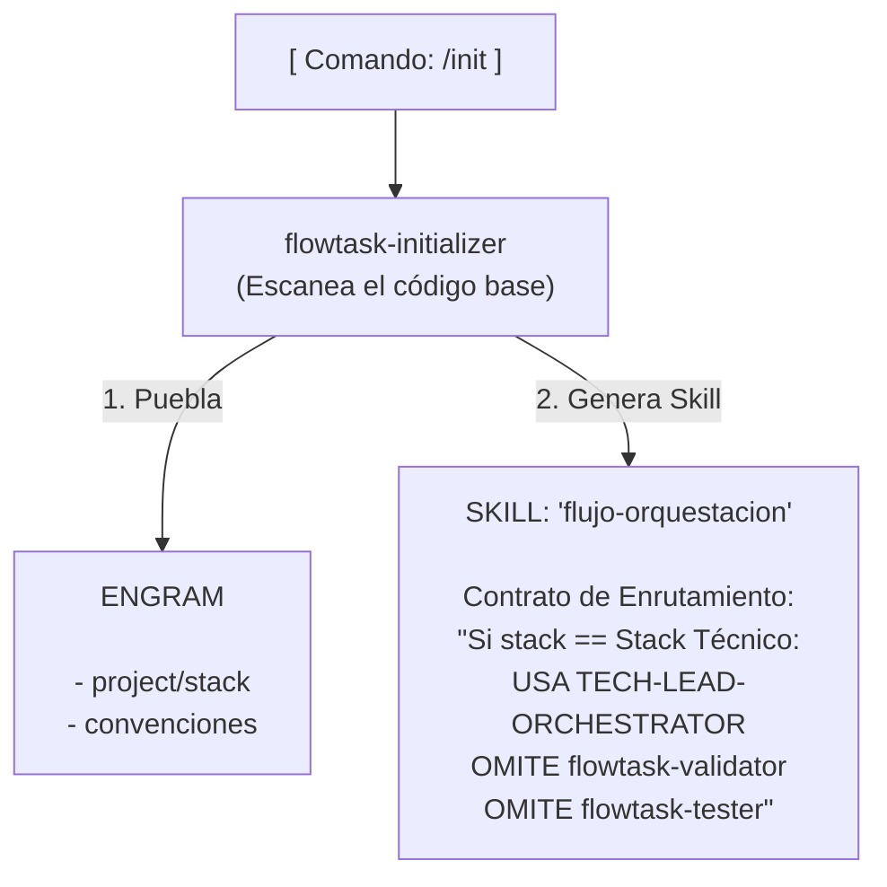

# Diseño del sub-agente Initializer



```text
┌─────────────────────────────────────────────────────────────────────────┐
│ LEYENDA 1: El Inicializador y Engram (Configuración por Proyecto)       │
├─────────────────────────────────────────────────────────────────────────┤
│ Muestra cómo el 'initializer' escanea el código base una única vez,     │
│ puebla la memoria de Engram con el stack y genera la skill de           │
│ enrutamiento dinámico que dicta las reglas inmutables para esa sesión.  │
└─────────────────────────────────────────────────────────────────────────┘
```
