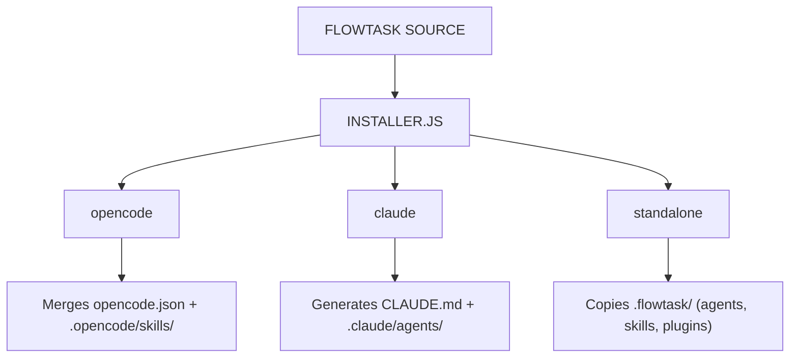

> **Historical:** this conceptual guide was replaced by [../installation.md](../installation.md). It does not describe current target selection or derived configuration.

## 5. The Installation System (Multi-Environment)

How FlowTask "clones" itself to work in different environments (OpenCode, Claude Code, Standalone).

