> **Histórico:** las cifras y comparativas de este documento no están verificadas por los contratos actuales. No las cites como capacidad disponible.

# Comparativa de flujo actual vs optimizado (LSP + AST-Grep)

```mermaid
flowchart TD
    subgraph ACTUAL["FLUJO ACTUAL scroll global"]
        A1["Planner recibe CA-006<br/>Lee .workspace/CA-006/ca.md<br/>Consulta Engram → contexto general del proyecto"]
        A2["Glob<br/>*.svelte → App.svelte, Login.svelte, Modal.svelte<br/>*.ts → api.ts, store.ts<br/>*.py → main.py, config.py<br/>────────────<br/>7 archivos encontrados"]
        A3["!! Lee archivos completos<br/>App.svelte 600 líneas<br/>Login.svelte 280 líneas<br/>main.py 340 líneas<br/>config.py 180 líneas<br/>────────────<br/>~1,400 líneas enviadas al LLM"]
        A4["!! Grep #quot;body#quot; / #quot;.app#quot; / #quot;overflow#quot;<br/>11 coincidencias — comentarios, strings, código activo<br/>LLM no distingue contexto semántico<br/>────────────<br/>ruido enviado al contexto"]
        A5["!! LLM adivina rango con offset+limit<br/>Read App.svelte [offset=380, limit=100]<br/>→ método de 120 líneas, pidió 100 → lectura incompleta<br/>Read App.svelte [offset=480, limit=60] → segunda pasada<br/>────────────<br/>2 lecturas adicionales, rango estimado"]
        A6["Plan generado<br/>~2,200 tokens de contexto consumidos"]

        A1 --> A2 --> A3 --> A4 --> A5 --> A6
    end

    subgraph OPTIMIZADO["FLUJO OPTIMIZADO — CA-006 scroll global"]
        B1["Planner recibe CA-006<br/>Lee .workspace/CA-006/ca.md<br/>Consulta Engram → contexto general del proyecto"]
        B2["Glob (igual)<br/>*.svelte → App.svelte, Login.svelte, Modal.svelte<br/>*.ts → api.ts, store.ts<br/>*.py → main.py, config.py<br/>────────────<br/>7 archivos encontrados"]
        B3["&gt;&gt; LSP lsp_symbols (scope=document)<br/>App.svelte → [:global(body):577, .app:590, .card:599]<br/>main.py → [bootstrap:145, db_init:67]<br/>config.py → [API_KEY:12, DB_URL:34]<br/>────────────<br/>índice compacto, 0 líneas de código al LLM"]
        B4["&gt;&gt; AST-Grep pattern match<br/>:global(body){$$$} → 8 líneas exactas<br/>.app{$$$} → 6 líneas exactas<br/>.card{$$$} → 5 líneas exactas<br/>────────────<br/>19 líneas exactas, sin ruido"]
        B5["Plan generado<br/>~180 tokens de contexto consumidos"]

        B1 --> B2 --> B3 --> B4 --> B5
    end

    A6 ~~~ B1
```



```text
!! = paso costoso    >> = paso optimizado
```
