> **Historical:** the figures and comparisons in this document are not verified by current contracts. Do not cite them as available capability.

# Comparison of current vs. optimized flow (LSP + AST-Grep)

```mermaid
flowchart TD
    subgraph ACTUAL["CURRENT FLOW global scroll"]
        A1["Planner receives CA-006<br/>Reads .workspace/CA-006/ca.md<br/>Queries Engram → general project context"]
        A2["Glob<br/>*.svelte → App.svelte, Login.svelte, Modal.svelte<br/>*.ts → api.ts, store.ts<br/>*.py → main.py, config.py<br/>────────────<br/>7 files found"]
        A3["!! Reads complete files<br/>App.svelte 600 lines<br/>Login.svelte 280 lines<br/>main.py 340 lines<br/>config.py 180 lines<br/>────────────<br/>~1,400 lines sent to the LLM"]
        A4["!! Grep #quot;body#quot; / #quot;.app#quot; / #quot;overflow#quot;<br/>11 matches — comments, strings, active code<br/>LLM cannot distinguish semantic context<br/>────────────<br/>noise sent to context"]
        A5["!! LLM guesses range with offset+limit<br/>Read App.svelte [offset=380, limit=100]<br/>→ 120-line method, requested 100 → incomplete read<br/>Read App.svelte [offset=480, limit=60] → second pass<br/>────────────<br/>2 additional reads, estimated range"]
        A6["Plan generated<br/>~2,200 tokens of context consumed"]

        A1 --> A2 --> A3 --> A4 --> A5 --> A6
    end

    subgraph OPTIMIZADO["OPTIMIZED FLOW — CA-006 global scroll"]
        B1["Planner receives CA-006<br/>Reads .workspace/CA-006/ca.md<br/>Queries Engram → general project context"]
        B2["Glob (same)<br/>*.svelte → App.svelte, Login.svelte, Modal.svelte<br/>*.ts → api.ts, store.ts<br/>*.py → main.py, config.py<br/>────────────<br/>7 files found"]
        B3["&gt;&gt; LSP lsp_symbols (scope=document)<br/>App.svelte → [:global(body):577, .app:590, .card:599]<br/>main.py → [bootstrap:145, db_init:67]<br/>config.py → [API_KEY:12, DB_URL:34]<br/>────────────<br/>compact index, 0 lines of code to the LLM"]
        B4["&gt;&gt; AST-Grep pattern match<br/>:global(body){$$$} → 8 exact lines<br/>.app{$$$} → 6 exact lines<br/>.card{$$$} → 5 exact lines<br/>────────────<br/>19 exact lines, no noise"]
        B5["Plan generated<br/>~180 tokens of context consumed"]

        B1 --> B2 --> B3 --> B4 --> B5
    end

    A6 ~~~ B1
```



```text
!! = expensive step    >> = optimized step
```
