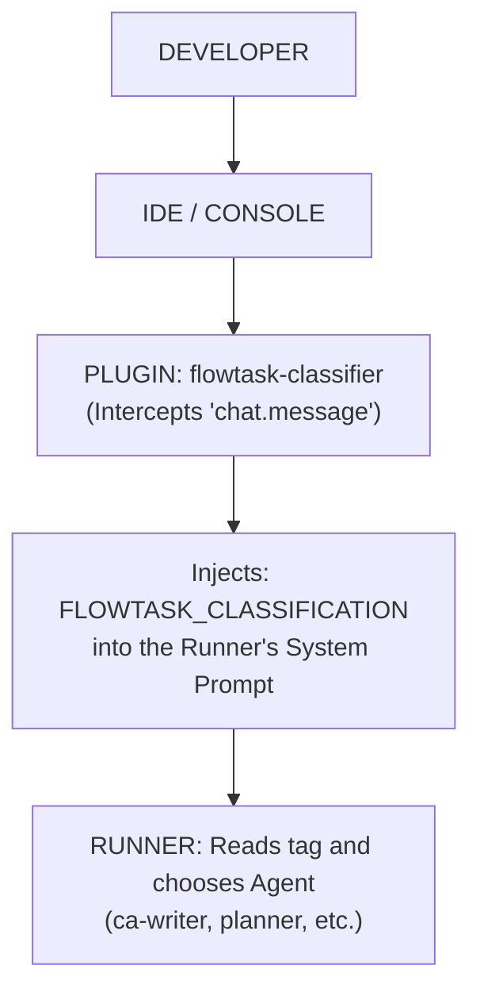

> **Historical:** this design describes the deprecated classifier and `FLOWTASK_CLASSIFICATION` injection. It is not the current mechanism. See [../project-history.md](../project-history.md).

## 2. The Classification System (Plugin Link)

How the plugin intercepts the message before the Runner processes it, preventing the Runner from having to "guess".

