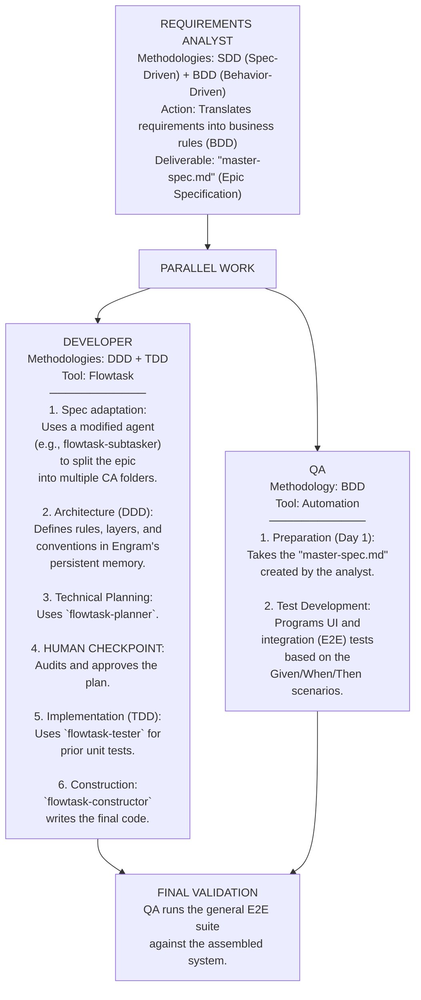

> **Historical:** this methodological design is not a current execution contract. See [../project-history.md](../project-history.md).

# Specification-Driven Development in FlowTask



```text
┌─────────────────────────────────────────────────────────────┐
│                  ABBREVIATION GLOSSARY                      │
├─────────────────────────────────────────────────────────────┤
│ SDD : Spec-Driven Development (Development based on the     │
│       main specification)                                   │
│ BDD : Behavior-Driven Development (Development based on     │
│       behavior: Given / When / Then)                        │
│ DDD : Domain-Driven Design (Domain-guided design:           │
│       Definition of architecture and conventions)           │
│ TDD : Test-Driven Development (Test-based development:      │
│       Create unit tests before the code)                    │
│ CA  : Acceptance Criterion (The sub-task to develop)        │
│ E2E : End-to-End (End-to-end system tests)                  │
│ QA  : Quality Assurance                                     │
└─────────────────────────────────────────────────────────────┘
```
