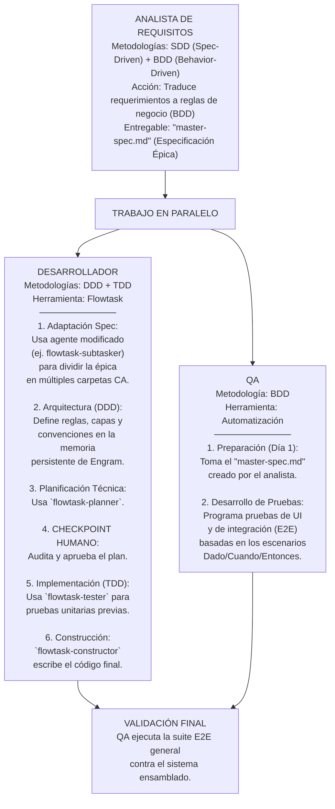

> **Histórico:** este diseño metodológico no es un contrato de ejecución vigente. Consultá [../project-history.md](../project-history.md).

# Specification-Driven Development en FlowTask



```text
┌─────────────────────────────────────────────────────────────┐
│                  GLOSARIO DE ABREVIACIONES                  │
├─────────────────────────────────────────────────────────────┤
│ SDD : Spec-Driven Development (Desarrollo basado en la      │
│       especificación principal)                             │
│ BDD : Behavior-Driven Development (Desarrollo basado en el  │
│       comportamiento: Dado que / Cuando / Entonces)         │
│ DDD : Domain-Driven Design (Diseño guiado por el dominio:   │
│       Definición de arquitectura y convenciones)            │
│ TDD : Test-Driven Development (Desarrollo basado en pruebas:│
│       Crear pruebas unitarias antes que el código)          │
│ CA  : Criterio de Aceptación (La sub-tarea a desarrollar)   │
│ E2E : End-to-End (Pruebas de extremo a extremo del sistema) │
│ QA  : Quality Assurance (Aseguramiento de la Calidad)       │
└─────────────────────────────────────────────────────────────┘
```
