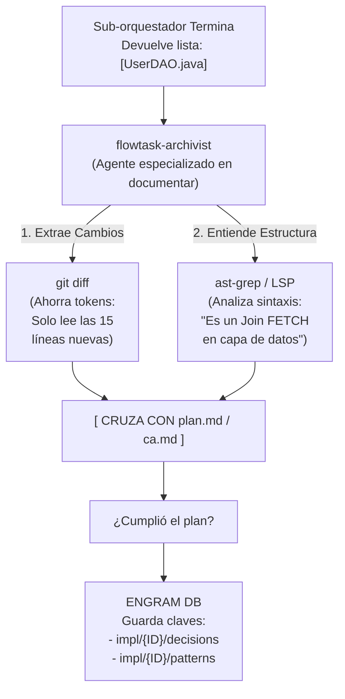

> **Histórico:** `flowtask-archivist` no forma parte del registro vigente de agentes. Consultá [../project-history.md](../project-history.md).

# Flujo del sub-agente Archivist



```text
┌─────────────────────────────────────────────────────────────────────────┐
│ LEYENDA 3: El Flujo del Archivist (Gestión de Memoria Eficiente)        │
├─────────────────────────────────────────────────────────────────────────┤
│ Detalla cómo el 'archivist' usa 'git diff' y 'ast-grep' cruzados con    │
│ el plan para documentar (sin juzgar) las decisiones técnicas y          │
│ patrones en Engram, ahorrando tokens al no leer todo el proyecto.       │
└─────────────────────────────────────────────────────────────────────────┘
```
