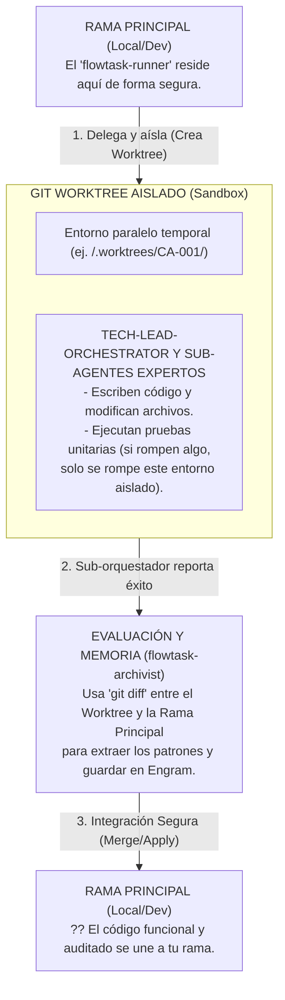

# Diseño conceptual de aislamiento con Git Worktrees



```text
┌─────────────────────────────────────────────────────────────────────────┐
│ LEYENDA 5: Ciclo de Vida y Aislamiento (Git Worktrees)                  │
├─────────────────────────────────────────────────────────────────────────┤
│ Demuestra la mitigación de riesgos. El 'runner' delega la tarea a un    │
│ 'Git Worktree' (una copia aislada del proyecto). Los sub-agentes        │
│ codifican y prueban allí sin afectar la rama principal. Solo cuando el  │
│ trabajo termina y el 'archivist' documenta el 'diff', el código se      │
│ integra a la rama del desarrollador humano.                             │
└─────────────────────────────────────────────────────────────────────────┘
```
