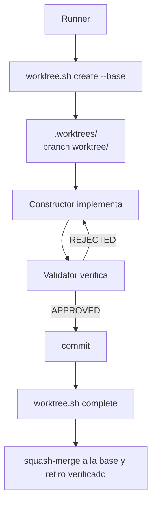

# Worktrees vigentes: aislamiento y cierre

La fuente operativa es `.flowtask/scripts/worktree.sh` y su implementación en
`.flowtask/scripts/lib/`. El gestor puede operar con FlowTask y Engram, o sobre
un repositorio genérico usando la configuración admitida por el script.

## Flujo normal

La rama base se detecta en el orden `development → main → trunk`; si ninguna
existe, se usa `main` como fallback, y el runner la pasa explícitamente. Si el
worktree o la rama ya existen por una interrupción, no se crea otro: se
reutiliza el existente.

## Subcomandos

| Subcomando | Propósito |
| --- | --- |
| `create <execution-name> [--base <branch>]` | Crea el worktree y su branch. |
| `complete <execution-name> [--base <branch>]` | Hace el cierre verificado, squash-merge y retiro de sus recursos. |
| `cleanup <execution-name> [--base <branch>]` | Retira el worktree sin integrar; `--discard` requiere autorización explícita. |
| `recover [<transaction-id>]` | Reanuda una transacción `--preserve-dirty` pendiente. |
| `prune` | Limpia metadatos stale y reporta directorios no asociados; no borra worktrees huérfanos. |
| `list` | Lista worktrees en disco para reconciliarlos con el estado de Engram. |

`create` no instala dependencias ni ejecuta pruebas por detección. `--prepare`
y `--verify` son opt-in y solo ejecutan comandos declarados. Cada subcomando
reporta `operation:` y `result:` además de las acciones omitidas o fallidas.

## Cierre seguro

`complete` solo retira el worktree y la branch que coinciden con la operación
que acaba de verificar. Después de validar la identidad, el estado, la
de-inicialización y la fase del journal, su ruta interna de cierre usa `git
worktree remove --force` para retirar el worktree ya cerrado. Eso no expone
`--discard` ni `git branch -D` como parte de `complete`; la branch se elimina
mediante una actualización condicionada al SHA esperado. Si hay un conflicto,
conserva el worktree y la branch para que el Constructor resuelva la situación.

La vía pública para retirar trabajo no integrado es `cleanup --discard`, que
requiere autorización explícita. `cleanup` sin `--discard` usa la retirada y la
eliminación de branch no forzadas cuando el estado permite hacerlo.

`cleanup` no descarta cambios implícitamente. `recover` usa locks de destino y
trabajo; si una restauración termina en `pending_manual`, conserva el backup y
deja instrucciones para resolución humana.

`--preserve-dirty` es una transacción opt-in: captura cambios elegibles en refs
privadas, registra cada fase en un journal y restaura el estado al finalizar.
Solo debe ofrecerse ante una instrucción humana explícita.

## Submodules y target-direct

El ciclo parent-only crea el worktree del repositorio parent. Los submodules no
se pueblan por defecto; `--init-submodules` es un opt-in explícito y su resultado
se persiste para permitir reanudar una inicialización interrumpida.

La implementación ejecutable es `.flowtask/scripts/worktree.sh`, que carga
`.flowtask/scripts/lib/worktree-manager-core.sh`. El documento auxiliar
`.flowtask/scripts/worktree.md` describe esta arquitectura, pero no se ejecuta
ni sustituye al script. El core carga
`.flowtask/scripts/lib/worktree-manager-target-direct.sh` para la variante
target-direct; ese script invoca el adaptador JavaScript de Runner/Constructor,
que usa `.flowtask/bin/lib/target-direct-transport.js` para validar, serializar
y rehidratar el descriptor. El transporte no es cargado directamente por el
wrapper shell.

La ruta target-direct requiere `--repo`, `--parent-repo`, `--target submodule` y
`--submodule-path`. El worktree vive en la raíz Git del submodule, no crea un
worktree del parent y solo puede preparar el gitlink staged con
`link-parent --link-parent staged-only`; no hace commit, merge ni push del
parent. `abort` restaura el índice bajo sus comprobaciones de drift.
