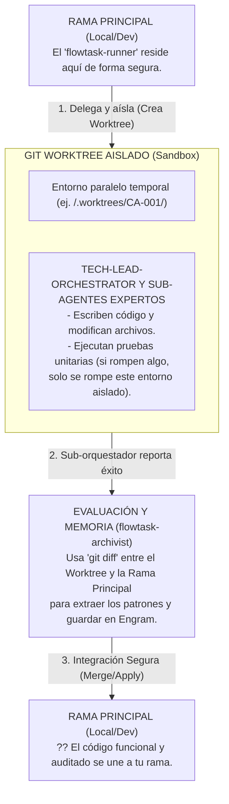

# Diseño conceptual de aislamiento con Git Worktrees



```text
┌─────────────────────────────────────────────────────────────────────────┐
│ LEYENDA 5: Ciclo de Vida y Aislamiento (Git Worktrees)                  │
├─────────────────────────────────────────────────────────────────────────┤
│ Demuestra la mitigación de riesgos. El 'runner' delega la tarea a un    │
│ 'Git Worktree' (una copia aislada del proyecto). Los sub-agentes        │
│ codifican y prueban allí sin afectar la rama principal. Solo cuando el  │
│ trabajo termina y el 'archivist' documenta el 'diff', el código se      │
│ integra a la rama del desarrollador humano.                             │
└─────────────────────────────────────────────────────────────────────────┘
```

## Lifecycle parent-only

El sandbox es siempre un worktree del repositorio parent; el cierre no coordina
un target directo de submodule ni `link-parent`. Los submodules quedan **no
poblados por defecto**. `--init-submodules` es un opt-in explícito de `create`
o `complete` y se persiste junto con su resultado para que una inicialización
interrumpida pueda reanudarse en el mismo worktree.

`complete` escribe un journal atómico y, después de validar parent, branch,
HEAD, gitlinks y todos los submodules recursivos, ejecuta `deinit` sin force,
verifica el estado desinicializado, usa `worktree remove --force` sólo en esa
ruta interna y elimina la branch con `update-ref` condicionado al SHA esperado.
Los crashes se reanudan por fase sin repetir squash, deinit o remove.

El `cleanup` público y `cleanup --discard` conservan su contrato actual y no
leen el journal de `complete`; `recover` sigue siendo exclusivo de
`--preserve-dirty` y nunca retira worktrees ni branches.
