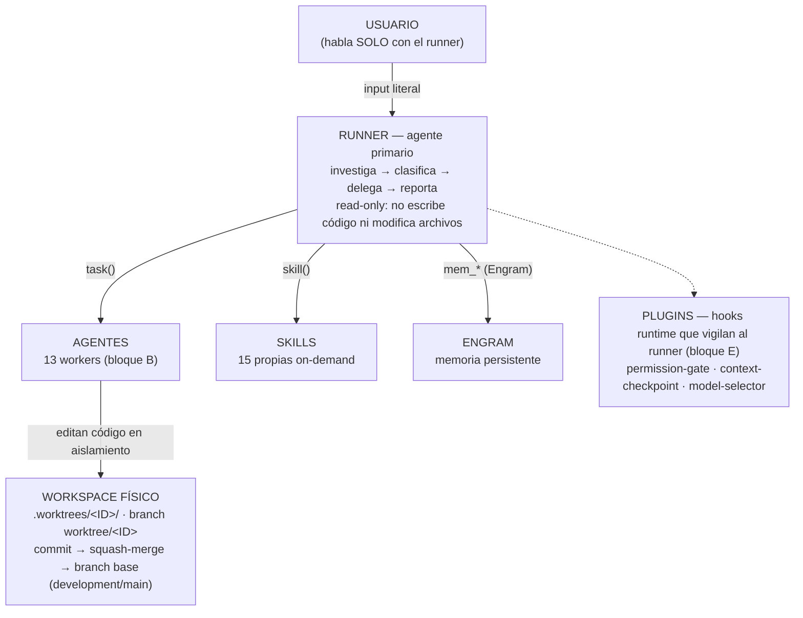

# FlowTask Core

> Fuente: `core-flowtask.pdf` — bloques 0, A, B, C, D y E.

## Tabla de contenidos

- [Bloque 0 — Qué es FlowTask](#bloque-0--qué-es-flowtask)
- [Bloque A — Ecosistema core](#bloque-a--ecosistema-core)
- [Bloque B — Agentes (13)](#bloque-b--agentes-13)
- [Bloque C — Flujo CA (Criterio de Aceptación)](#bloque-c--flujo-ca-criterio-de-aceptación)
- [Bloque D — Flujo HF (Hotfix acordado)](#bloque-d--flujo-hf-hotfix-acordado)
- [Bloque E — Plugins](#bloque-e--plugins)

---

## Bloque 0 — Qué es FlowTask

### Qué es FlowTask

FlowTask es un sistema de workflow de desarrollo asistido por IA con memoria
persistente (Engram). No es un agente: es un **orquestador**. Un agente primario
—el RUNNER— recibe al desarrollador y coordina un equipo de agentes
especializados que se reparten el trabajo de punta a punta: capturar
requisitos, planificar, implementar y validar.

El desarrollador habla SOLO con el runner. El runner investiga, clasifica la
intención, delega en el subagente correcto y reporta el resultado. Ningún
agente ejecuta el trabajo de otro: `ca-writer` define requisitos, `planner`
planifica, `constructor` implementa, `validator` valida. El runner nunca escribe
código ni archivos.

### Problema que resuelve

Automatizar el ciclo de desarrollo sin perder trazabilidad ni control humano:
cada paso deja un artefacto persistente en Engram (requisito, plan, auditoría,
validación) y las decisiones quedan auditables entre sesiones.

### Los 3 pilares

| Pilar | Nombre | Función |
| --- | --- | --- |
| **P1** | Git Worktrees | Aislamiento: cada trabajo corre en su propio `worktree`/`branch`; varios flujos en paralelo sin pisarse. |
| **P2** | Engram + Handshake | Memoria e identidad: artefactos y estado operativo persisten; los agentes se reanudan con contexto. |
| **P3** | LSP + AST-Grep | Lectura eficiente de código: entender el proyecto sin volcar archivos enteros. |

### Dos flujos de ejecución

- **CA (Criterio de Aceptación)** — ciclo completo y trazable: requisito → plan →
  auditoría → gate → implementación → validación.
- **HF (Hotfix acordado)** — corrección YA diagnosticada y acordada, sin abrir el
  ciclo CA completo.

### Sistema de personalidades

Una capa que le da voz propia al runner. No hay un registro único: FlowTask
define tres personalidades — tutor didáctico, mentor de pares y par técnico que
debate de igual a igual — y el runner adopta una según el perfil del
desarrollador. La personalidad cambia el tono y la profundidad de la
conversación, no las reglas de orquestación.

### Cómo leer este documento

| Bloque | Contenido |
| --- | --- |
| Bloque A | ecosistema core |
| Bloque B | agentes (13) |
| Bloque C | flujo CA |
| Bloque D | flujo HF |
| Bloque E | plugins |

---

## Bloque A — Ecosistema core

### FlowTask Core — Ecosistema



Pilares documentados: Git Worktrees (aislamiento) · Engram + Handshake
(memoria e identidad) · LSP + AST-Grep (lectura eficiente de código).

El runner enruta por intención; los comandos explícitos se retiraron y su
relato queda en `docs/project-history.md`.

---

## Bloque B — Agentes (13)

### Agentes de FlowTask (13)

```text
│
├─ PRIMARIO
│    runner ............ orquesta todo; el desarrollador habla solo con él
│
├─ PIPELINE CA — delegación secuencial del runner
│    ca-writer ......... define requisitos y reglas de negocio (trat. completo)
│    planner ........... genera el plan decision-complete      (trat. completo)
│    plan-auditor ...... audita el plan (>5 tareas o Evolution Mode)
│    constructor ....... implementa el plan en un worktree
│    validator ......... valida implementación vs plan + convenciones
│
├─ SOPORTE — delegación puntual
│    inspector ............. exploración/análisis read-only; tradeoffs y GAPs
│    review-orchestrator ... code review 4R: R1 riesgo, R2 legibilidad,
│                            R3 confiabilidad, R4 resiliencia (read-only)
│    tester ................ genera tests (no toca código de producción)
│    logger ................ instrumenta logging (no toca lógica de negocio)
│    initializer ........... escanea el proyecto → Engram (stack, capas, etc.)
│    graphify-docs-media ... docs/media de Graphify en background
│    onboarder ............. quiz de nivel → personalidad del runner
│
└─ CONTINUIDAD (handshake-protocol)
     tratamiento completo: ca-writer, planner → reanudan hilo (task_id)
     tratamiento ligero:   resto → siempre hilo fresco (checkpoint = traza)
```

---

## Bloque C — Flujo CA (Criterio de Aceptación)

### Flujo CA — Criterio de Aceptación

*(runner delega; nunca ejecuta el trabajo)*

```text
input del dev: CHANGE_REQUEST · CA_MENTION · CA-{ID}
│
▼
RUNNER clasifica ── ¿existe el CA en Engram?
│
├─ no existe ──▶ [1] CA-WRITER
│                 conversación de clarificación: comportamiento observable,
│                 condiciones de fallo, reglas de negocio, tradeoffs y GAPs
│                 salida: ca/CA-{ID}/artifact/ca
│                 flow-state: flow-state/CA-{ID}/create
│
└─ ya existe ──┐
              ▼
        [2] PLANNER ── plan decision-complete
            salida: ca/CA-{ID}/artifact/plan (incluye gate_status)
            flow-state: flow-state/CA-{ID}/plan
              │
              ▼
        [3] PLAN-AUDITOR ── solo si >5 tareas o Evolution Mode
            salida: ca/CA-{ID}/artifact/audit (verdict OKAY, 0 blockers)
              │
              ▼
        [4] GATE DE EJECUCIÓN
            verifica: plan final existe + gate_status con blockers NONE y
            pending_decisions [] + audit OKAY si audit_required
            FAIL → aborta (sin worktree, sin constructor) — ni --auto lo salta
              │ PASS
              ▼
        [5] CHECKPOINT HUMANO ── el dev escribe "ejecutar"
            (--auto solo exime la espera; el Gate se verifica igual)
              │
              ▼
        [6] WORKTREE ── worktree.sh create CA-{ID} --base {development|main}
            → .worktrees/CA-{ID} · branch worktree/CA-{ID}
              │
              ▼
        [7] CONSTRUCTOR ── implementa el plan en el worktree
            no decide diseño; sigue el orden y las convenciones del plan
            flow-state: flow-state/CA-{ID}/construct
              │
              ▼
        [8] VALIDATOR ── N1: cumplimiento del plan
            N2: convenciones del proyecto
            salida: ca/CA-{ID}/artifact/validacion (score /100)
              │
              ├─ REJECTED ──▶ vuelve a [7] · máximo 2 intentos → escala al dev
              │
              ▼ APPROVED
        [9] CIERRE ── commit → worktree.sh complete (squash-merge a la base)
             → ca_status: closed + purga de task_id huérfanos + session summary
```

### Gestor portable y cierre seguro

`worktree.sh` puede operar sobre un repositorio genérico con `--repo` y un
archivo de configuración `key=value` pasado con `--config`; no necesita CA,
Engram ni FlowTask. La configuración no se ejecuta como shell y solo admite
las claves documentadas en el README. `create` no instala dependencias ni
ejecuta pruebas por detección: `--prepare` y `--verify` son opt-in, requieren
comandos declarados y se ejecutan en ese orden.

El cierre conserva el squash, pero su limpieza usa una capacidad efímera
interna verificada contra el commit de origen, el worktree, la rama y el
commit squash. No usa `--discard`, `-D` ni borrado forzado, y esa capacidad no
es alcanzable desde `recover` ni desde la configuración: si un recover termina
un squash, deja el worktree y la rama en su sitio y el retiro posterior pasa por
el `cleanup` público. En cambio, `cleanup --discard` es la única vía pública
que puede retirar trabajo no integrado, después de revalidar su identidad.
`complete`, `recover` y `cleanup` comparten locks ordenados de destino/trabajo;
el segundo proceso falla inmediatamente y no toca backups. Los resultados
distinguen operación, resultado, acciones omitidas o fallidas, recuperación y
limpieza; nunca se informa cierre completo mientras quede un recurso o
restauración pendiente.

---

## Bloque D — Flujo HF (Hotfix acordado)

### Flujo HF — Hotfix acordado (sin CA)

**Origen.** El runner investiga y diagnostica conversacionalmente (skill
`investigacion` + Graphify + Engram). El dev converge en una corrección y
escribe el evento literal: `"ejecutar"`.

**Para qué.** Ejecutar una corrección YA diagnosticada y acordada, sin abrir el
ciclo CA completo.

**Por qué.** El flujo CA exige intermediar requisitos (`ca-writer`),
planificación (`planner`) y auditoría (`plan-auditor`): eso agrega latencia y
separa la conversación de diagnóstico de la decisión de actuar. El HF
conserva lo esencial —investigación persistida, plan mínimo, worktree aislado,
validación y cierre por squash-merge— pero NO crea CA ni invoca
`ca-writer`/`planner`/`plan-auditor`.

> **Origen:** CA-HOTFIX-MODE (12-ago-2026).
> **Tradeoff asumido:** segundo flujo y contrato de persistencia a cambio de menos fricción.
> **Garantía:** aunque no haya CA, ningún hotfix pierde investigación, plan mínimo, worktree ni validación.

```text
[1] ID ── slug kebab-case → HF-{slug}
    colisión → HF-{slug}-2, -3... (nunca sobrescribe historial)
[2] PERSISTIR ── hotfix/{id}/artifact/investigacion
                 hotfix/{id}/artifact/plan (archivos afectados, cambios
                 acordados, criterios de aceptación verificables)
[3] WORKTREE ── worktree.sh create hotfix/{id} --base {base detectada}
    (orden: development → main → trunk → main)
    → .worktrees/hotfix/{id} · branch worktree/hotfix/{id}
[4] CONSTRUCTOR ── implementa el plan mínimo (execution_id=hotfix/{id})
[5] VALIDATOR ── → hotfix/{id}/artifact/validacion (no pasa por plan-auditor)
    REJECTED → vuelve a [4] · máximo 2 intentos → escala
[6] CIERRE ── commit → worktree.sh complete (squash-merge a la base)
```

**Ejemplo real:** `HF-diagramas-architecture-md` (23-sep-2026) convirtió los 14
diagramas de `docs/architecture/` de `.txt` (CP1252 roto) a `.md` UTF-8 con Mermaid.
Squash-merge a `main` en `198cf54` — es el HF que produjo ESTE archivo.

---

## Bloque E — Plugins

### Plugins — hooks runtime de OpenCode

**Manifest:** `.flowtask/plugins/flowtask-plugins.json`

#### Activos

| Plugin | Kind | Función |
| --- | --- | --- |
| `flowtask-permission-gate` | server | permisos del runner + gate de commit |
| `flowtask-context-checkpoint` | server | checkpoint forzado al 70% de contexto |
| `flowtask-model-selector` | tui | elige modelo por agente |

#### `flowtask-permission-gate` (detalle)

- autoriza las tools del runner (`read`/`glob`/`grep`/`skill`/`mem_*`/`graphify`)
- autoriza `bash` del runner (whitelist: `worktree.sh`, git read-only, commit)
- bloquea `task()` a subagentes fuera de la lista → *"delegá al subagente"*
- gate de commit: exige `.review-stamp` vigente (TTL 30 min; bypass ≤5 líneas)
- presupuesto de contexto: bloquea `read`/`glob`/`grep` que exceden umbrales

#### `flowtask-context-checkpoint` (detalle)

- detecta child sessions (subagentes) y mide su ventana de contexto
- al ≥70% inyecta la orden de checkpoint en Engram + tag de capacidad
- si el subagente ignora 2 steps consecutivos → warning en logs

#### Deprecados

Manifest: `"deprecated": true`, `"enabled": false` — no se instalan.

- `flowtask-classifier-hook` (server) — inyectaba `FLOWTASK_CLASSIFICATION`
- `flowtask-classifier-tui` (tui) — indicador visual del clasificador

#### Remanente

- `flowtask-review-gate` — absorbido por `permission-gate` (ago-2026); su carpeta
  conserva solo `node_modules` + `package-lock`
