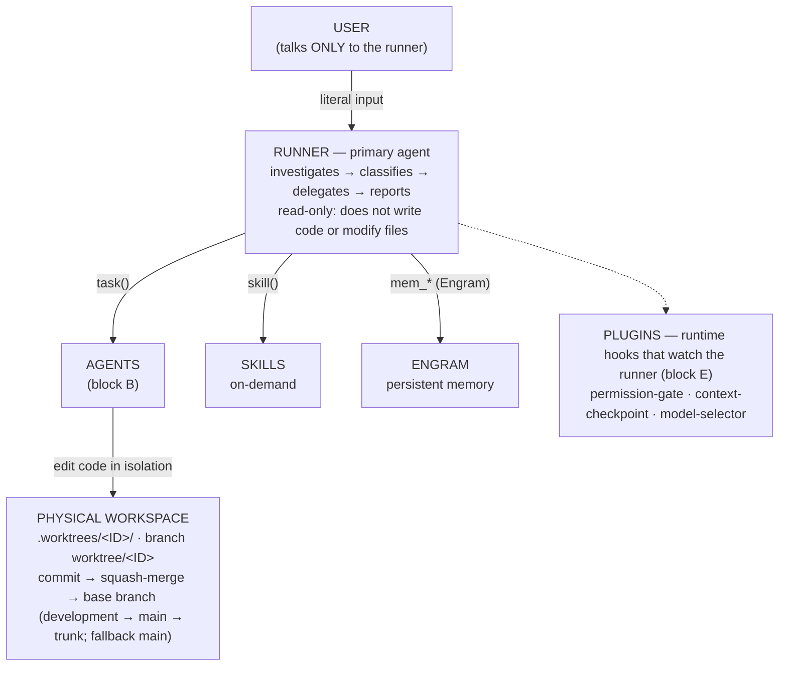

# FlowTask Core

> This document is the current technical reference for FlowTask; its statements
> are checked against the executable contracts under `.flowtask/` and the
> versioned documentation under `docs/`. It does not depend on an external PDF file.

## Table of contents

- [Block 0 — What FlowTask is](#block-0--what-flowtask-is)
- [Block A — Core ecosystem](#block-a--core-ecosystem)
- [Block B — Delegation](#block-b--delegation)
- [Block C — CA flow (Acceptance Criterion)](#block-c--ca-flow-acceptance-criterion)
- [Block D — HF flow (Agreed hotfix)](#block-d--hf-flow-agreed-hotfix)
- [Block E — Plugins](#block-e--plugins)

---

## Block 0 — What FlowTask is

### What FlowTask is

FlowTask is an AI-assisted development workflow system with persistent memory
(Engram). It is not an agent: it is an **orchestrator**. A primary agent
—the RUNNER— receives the developer and coordinates registered subagents that
split the work end to end: capture requirements, plan, implement, and validate.

The developer talks ONLY to the runner. The runner investigates, classifies the
intent, delegates to the corresponding subagent, and reports the result. The
runner never writes code or files.

### The problem it solves

Automate the development cycle without losing traceability or human control:
each step leaves a persistent artifact in Engram (requirement, plan, audit,
validation) and decisions remain auditable across sessions.

### The pillars

| Pillar | Name | Function |
| --- | --- | --- |
| **P1** | Git Worktrees | Isolation: each job runs in its own `worktree`/`branch`; several flows in parallel without stepping on each other. |
| **P2** | Engram + Handshake | Memory and identity: artifacts and operational state persist; agents resume with context. |

### Two execution flows

- **CA (Acceptance Criterion)** — full, traceable cycle: requirement → plan →
  audit → gate → implementation → validation.
- **HF (Agreed hotfix)** — a correction that is ALREADY diagnosed and agreed,
  without opening the full CA cycle.

### Personality system

A layer that gives the runner its own voice. There is no single registry: FlowTask
defines three personalities — didactic tutor, peer mentor, and technical peer who
debates as an equal — and the runner adopts one according to the developer's
profile. Personality changes the tone and depth of the conversation, not the
orchestration rules.

Personality only defines tone and depth; it does not authorize or restrict actions.
Technical authorization lives in the permissions layer and initiative in the
autonomy layer. The contract for the three layers is in
[architecture/persona-autonomy-permissions-layers.md](architecture/persona-autonomy-permissions-layers.md).

### How to read this document

| Block | Content |
| --- | --- |
| Block A | core ecosystem |
| Block B | delegation and runtime contracts, without an editorial inventory |
| Block C | CA flow |
| Block D | HF flow |
| Block E | plugins |

---

## Block A — Core ecosystem

### FlowTask Core — Ecosystem



Documented pillars: Git Worktrees (isolation) · Engram + Handshake
(memory and identity).

The runner routes by intent; explicit commands were retired and their story
remains in `docs/project-history.md`.

---

## Block B — Delegation

The subagents that the runtime can invoke are registered in the target
configuration and their executable contracts live under `.flowtask/agents/`.
This document does not duplicate that editorial inventory: the CA and HF
sections describe only the observable order of the flow, and the installation
documentation explains how those resources are installed and updated.

---

## Block C — CA flow (Acceptance Criterion)

### CA flow — Acceptance Criterion

*(runner delegates; never executes the work)*

```text
dev input: CHANGE_REQUEST · CA_MENTION · CA-{ID}
│
▼
RUNNER classifies ── does the CA exist in Engram?
│
├─ does not exist ──▶ [1] CA WRITER
│                 clarification conversation: observable behavior,
│                 failure conditions, business rules, tradeoffs, and GAPs
│                 output: ca/CA-{ID}/artifact/ca
│                 flow-state: flow-state/CA-{ID}/create
│
└─ already exists ──┐
              ▼
        [2] PLANNER ── decision-complete plan
            output: ca/CA-{ID}/artifact/plan (includes gate_status and verified evidence)
            flow-state: flow-state/CA-{ID}/plan
              │
              ▼
        [3] PLAN-AUDITOR ── only if >5 tasks or Evolution Mode
            output: ca/CA-{ID}/artifact/audit (verdict OKAY, 0 blockers)
              │
              ▼
        [4] EXECUTION GATE
            checks: final plan exists + gate_status with blockers NONE and
            pending_decisions [] + audit OKAY if audit_required +
            material evidence: no unverified material data
            FAIL → aborts (no worktree, no constructor) — not even --auto skips it
              │ PASS
              ▼
        [5] AUTOMATIC START ── the dev's order + Gate PASS enable
            construction (no routine wait; the Gate is still checked)
              │
              ▼
        [6] WORKTREE ── worktree.sh create CA-{ID} --base {detected base}
            (order: development → main → trunk; fallback main)
            → .worktrees/CA-{ID} · branch worktree/CA-{ID}
              │
              ▼
        [7] CONSTRUCTOR ── implements the plan in the worktree
            does not decide design; follows the plan's order and conventions
            flow-state: flow-state/CA-{ID}/construct
              │
              ▼
        [8] GAP-DRIVEN TESTER ── generates tests only for declared gaps
            at most one test per gap and a ceiling of three per delivery; default 0
            report: ca/CA-{ID}/artifact/tests-report
            no gaps: continues to validation without generating or waiting
              │
              ▼
        [9] VALIDATOR ── live validation
            inherits the test report without repeating what was checked
            N1: plan compliance
            N2: project conventions
            N3: coordination hygiene (reference scanner)
            checks executed with command and result
            round: closure (closes) | intermediate (verifies what was reached)
            single verdict: APPROVED | REJECTED | OPERATIONAL_FAILURE
            reusable evidence: ca/CA-{ID}/artifact/validacion
              │
              ├─ REJECTED ──▶ returns to [7] with the rejection evidence
              │              second rejection → Inspector → returns to [7]
              │
              ├─ OPERATIONAL_FAILURE ──▶ preserves state and history
              │                          operational recovery or pause
              │
              ▼ APPROVED with final=true
        [10] CLOSE ── commit → worktree.sh complete (squash-merge to the base, with meaningful --title/--body)
              → ca_status: closed + purge of orphan task_ids + session summary
```

### Portable manager and safe close

`worktree.sh` can operate on a generic repository with `--repo` and a
`key=value` configuration file passed with `--config`; it does not need a CA,
Engram, or FlowTask. The configuration is not executed as a shell and only accepts
the keys documented in the README. `create` does not install dependencies or
run tests by detection: `--prepare` and `--verify` are opt-in, require declared
commands, and run in that order.

The close preserves the squash, but its cleanup uses an internal ephemeral and
verified capability: after validating identity, state, de-initialization, and
journal, `complete` runs `git worktree remove --force` on the closed worktree
and deletes the branch with an update conditioned on the expected SHA.
`complete` does not expose `--discard` or `git branch -D`. Instead,
`cleanup --discard` is the only public path to remove unintegrated work and
requires explicit authorization. That internal capability is not reachable from
`recover` or from configuration: if a recover finishes a squash, it leaves the
worktree and branch in place, and later removal goes through the public
`cleanup`.
`complete`, `recover`, and `cleanup` share ordered target/work locks;
the second process fails immediately and does not touch backups. Results
distinguish operation, result, skipped or failed actions, recovery, and
cleanup; a complete close is never reported while any resource or
restoration remains pending.

The CA2 target-direct path requires an explicit target (`--repo` of the submodule,
`--parent-repo`, `--target submodule`, and `--submodule-path`). The parent can only
receive a staged gitlink through `link-parent --link-parent staged-only`;
no parent worktree is created and no commit, push, or merge is made. `abort` uses the
binary index snapshot and blocks on foreign drift. The manager requires Git
2.17.0 or later (`git worktree remove`); the version is not checked at
runtime. Parent-only preserves its previous contract.

---

## Block D — HF flow (Agreed hotfix)

### HF flow — Agreed hotfix (without a CA)

**Origin.** The runner investigates and diagnoses conversationally (skill
`investigacion` + Graphify + Engram). The dev converges on a correction and
explicitly accepts it: that acceptance is the start signal and a second
confirmation is not required.

**Purpose.** Execute a correction that is ALREADY diagnosed and agreed, without
opening the full CA cycle.

**Why.** The CA flow requires intermediating requirements (`ca-writer`),
planning (`planner`), and audit (`plan-auditor`): that adds latency and
separates the diagnostic conversation from the decision to act. The HF
preserves the essentials —persisted research, a minimal plan, an isolated
worktree, validation, and close by squash-merge— but does NOT create a CA or
invoke `ca-writer`/`planner`/`plan-auditor`.

> **Origin:** hotfix flow, introduced as a second bounded path in August 2026.
> **Assumed tradeoff:** a second flow and persistence contract in exchange for less friction.
> **Guarantee:** even without a CA, no hotfix loses research, minimal plan, worktree, or validation.

```text
[1] ID ── kebab-case slug → HF-{slug}
    collision → HF-{slug}-2, -3... (never overwrites history)
[2] PERSIST ── hotfix/{id}/artifact/investigacion
                 hotfix/{id}/artifact/plan (affected files, agreed
                 changes, verifiable acceptance criteria)
[3] WORKTREE ── worktree.sh create hotfix/{id} --base {detected base}
    (order: development → main → trunk; fallback main)
    → .worktrees/hotfix/{id} · branch worktree/hotfix/{id}
[4] CONSTRUCTOR ── implements the minimal plan (execution_id=hotfix/{id})
[5] VALIDATOR ── → hotfix/{id}/artifact/validacion (does not go through plan-auditor)
    REJECTED → returns to [4] with the rejection evidence
              second rejection → Inspector → returns to [4]
[6] CLOSE ── commit → worktree.sh complete (squash-merge to the base)
```

**Real example:** a diagrams hotfix (Sep 23, 2026) converted the 14
diagrams in `docs/architecture/` from `.txt` (broken CP1252) to UTF-8 `.md` with Mermaid.
Squash-merge to `main` at `198cf54` — it is the hotfix that produced THIS file.

---

## Block E — Plugins

### Plugins — OpenCode runtime hooks

**Manifest:** `.flowtask/plugins/flowtask-plugins.json`

#### Active

| Plugin | Kind | Function |
| --- | --- | --- |
| `flowtask-permission-gate` | server | runner permissions + commit gate |
| `flowtask-context-checkpoint` | server | forced checkpoint at 70% context |
| `agent-model-selector-opencode` | cli (TUI) | selects model and variant per agent |
| `agent-model-selector-claude-code` | mod | selects the model per agent in Claude Code |

#### `flowtask-permission-gate` (detail)

- authorizes the runner's tools (`read`/`glob`/`grep`/`skill`/`mem_*`/`graphify`)
- authorizes the runner's `bash` (whitelist: `worktree.sh`, read-only git, commit)
- blocks `task()` to subagents outside the list → *"delegate to the subagent"*
- commit gate: requires a current `.review-stamp` (30 min TTL; bypass ≤5 lines)
- context budget: degrades by levels (warning, reduced delivery, per-turn omission) and blocks attachments to the runner

#### `flowtask-context-checkpoint` (detail)

- detects child sessions (subagents) and measures their context window
- at ≥70% injects the checkpoint order in Engram + capability tag
- if the subagent ignores 2 consecutive steps → warning in logs

#### `agent-model-selector-opencode` (detail)

- installs from the submodule `.flowtask/plugins/agent-model-selector/packages/opencode`
- copies only `dist`, `package.json`, and `README.md` according to the manifest's `files` allowlist
- registers the entrypoint `dist/tui.js` in `.opencode/cli.json`
- removes the legacy `flowtask-model-selector` installation (directory and configuration entries) after copying and validating the replacement

#### `agent-model-selector-claude-code` (detail)

- installs from the submodule `.flowtask/plugins/agent-model-selector/packages/claude-code`
- the manifest declares `kind: "mod"`, `destinations: ["claude-code"]` and the hooks entrypoint `hooks/dist/register.js`; the OpenCode installer discards entries without the `opencode` destination before copying or registering anything, so this entry is inert for OpenCode
- the Claude Code runtime consumes the payload (`files`: `.claude-plugin`, `hooks/dist`, `hooks/hooks.json`, `package.json`, `README.md`); loading it with `claude --plugin-dir <path>` is the development path
- exposes `/flowtask-model` with `list`, `set`, `clear`, `clear --all`, `export` and `import`; the pane shows one row per agent with a `Select` and a Clear button where the surface has those elements
- persists one store key per project and agent: `flowtask-model:v1:<encoded-root>:<agent-key>`; it does not write frontmatter or settings
- applies the override in the `agent.spawn` hook; forks and resumes ignore the model and the Mod logs that it did
- requires Claude Code `2.1.287`; `2.1.299` is recommended and `2.1.304` adds `availableModels` from settings
- in `-p`, Agent SDK or any surface without a pane the command keeps working; the listing goes to the log and the answer text

#### Claude Code Mod rollback

1. Run `/flowtask-model clear --all` in each project that used an override.
2. Remove or disable the plugin in Claude Code (`--plugin-dir` removal, or the plugin manager).
3. Confirm that `/flowtask-model` no longer exists and that OpenCode is unchanged: the Mod never writes `.opencode`, `opencode.json` or the global OpenCode configuration.

#### Selector rollback

1. `git submodule deinit -f .flowtask/plugins/agent-model-selector`
2. `git rm .flowtask/plugins/agent-model-selector` and remove the entry from `.gitmodules`
3. `git checkout <previous-commit> -- .flowtask/plugins/flowtask-model-selector .flowtask/plugins/flowtask-plugins.json .flowtask/bin/lib/installer.js .flowtask/bin/lib/installer.test.js .flowtask/bin/lib/copy.js docs/core-flowtask.md docs/README.md .flowtask/package.json`
4. `rm -rf .opencode/plugins/agent-model-selector-opencode`
5. `flowtask update`

The user's model configuration is not modified during rollback.

#### Deprecated

Manifest: `"deprecated": true`, `"enabled": false` — they are not installed.

- `flowtask-classifier-hook` (server) — injected `FLOWTASK_CLASSIFICATION`
- `flowtask-classifier-tui` (tui) — visual classifier indicator

---
## Planned evolution
The implementation plan for Agent Loop and Hermes, with phases, dependencies, and gates, lives in [roadmap/agent-loop-hermes.md](./roadmap/agent-loop-hermes.md). The F0–F4 labels are for planning and are not used in commit messages. Commits describe what was done.
